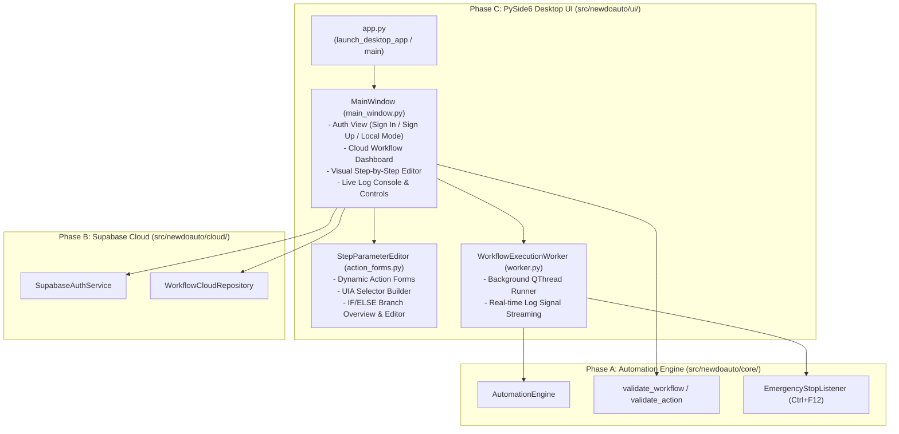

# NewDoAuto — Phase C Implementation Report (Windows Desktop Application)

**Date**: October 30, 2026  
**Repository**: [https://github.com/Daskrw/NewDoAuto](https://github.com/Daskrw/NewDoAuto)  
**Target Platform**: Windows 10/11 (64-bit)  
**UI Technology**: PySide6 (`PySide6-Essentials` / Qt for Python)

---

## 1. Architecture & Decoupling

Phase C introduces the native Windows desktop GUI (`src/newdoauto/ui/`) built with **PySide6**, layered cleanly on top of the existing Phase A Windows UI Automation engine (`src/newdoauto/core/` and `src/newdoauto/actions/`) and Phase B Supabase cloud persistence (`src/newdoauto/cloud/`).



### Key Architectural Guarantees
1. **Zero Business Logic Duplication**: The UI calls [`SupabaseAuthService`](file:///c:/Users/Daskr/OneDrive/Desktop/My%20Works/UU%20Studio/Apps/REA%20EA/NewDoAuto/src/newdoauto/cloud/auth.py#L56-L302), [`WorkflowCloudRepository`](file:///c:/Users/Daskr/OneDrive/Desktop/My%20Works/UU%20Studio/Apps/REA%20EA/NewDoAuto/src/newdoauto/cloud/repository.py#L53-L296), [`AutomationEngine`](file:///c:/Users/Daskr/OneDrive/Desktop/My%20Works/UU%20Studio/Apps/REA%20EA/NewDoAuto/src/newdoauto/core/engine.py#L22-L154), [`ActionRegistry`](file:///c:/Users/Daskr/OneDrive/Desktop/My%20Works/UU%20Studio/Apps/REA%20EA/NewDoAuto/src/newdoauto/actions/registry.py#L23-L52), and [`validate_workflow`](file:///c:/Users/Daskr/OneDrive/Desktop/My%20Works/UU%20Studio/Apps/REA%20EA/NewDoAuto/src/newdoauto/models/validation.py#L90-L126) directly.
2. **Supabase-Only Cloud Database**: No SQLite or competing local database was introduced.
3. **Offline & Local-Mode Resilient**: If `.env` is unconfigured or the PC is offline, `MainWindow` starts safely on the Authentication screen with a clear notice and a **Continue to Editor (Local Mode)** button so local JSON workflows can still be created, edited, validated, and executed.
4. **Lossless Round-Trip Serialization**: [`Workflow`](file:///c:/Users/Daskr/OneDrive/Desktop/My%20Works/UU%20Studio/Apps/REA%20EA/NewDoAuto/src/newdoauto/models/workflow.py#L101-L152), [`Action`](file:///c:/Users/Daskr/OneDrive/Desktop/My%20Works/UU%20Studio/Apps/REA%20EA/NewDoAuto/src/newdoauto/models/workflow.py#L49-L98), and [`ErrorPolicy`](file:///c:/Users/Daskr/OneDrive/Desktop/My%20Works/UU%20Studio/Apps/REA%20EA/NewDoAuto/src/newdoauto/models/workflow.py#L19-L46) preserve any unknown/extra top-level or parameter keys (`extra_fields`) and nested `flow.if_else` branches (`then` and `else`) during load, edit, and save.

---

## 2. Implemented Desktop MVP Features

### A. Authentication
- **Sign In & Registration**: Dedicated email and masked password inputs (`QLineEdit.Password`) calling `SupabaseAuthService.sign_in()` and `SupabaseAuthService.sign_up()`.
- **Session Restoration**: Automatically calls `restore_session()` on launch when enabled.
- **Sign Out & Cross-Account Isolation**: Clicking **Sign Out** prompts if unsaved workflow edits exist, calls `auth_service.sign_out()`, immediately clears `workflow_list_widget` and in-memory cloud workflow records, and resets the editor so one user's workflows can never appear in another user's session.
- **Sanitized Error Handling**: Displays clear feedback for `InvalidCredentialsError`, `SessionExpiredError`, `CloudNetworkError`, and `CloudConfigError` with all tokens/passwords redacted.

### B. Cloud Workflow Dashboard
- Displays the authenticated user's workflows via `WorkflowCloudRepository.list_workflows()`.
- Supports **+ New**, **Open** (or double-click), **Rename**, **Delete** (with confirmation dialog), and **Refresh**.
- Provides clear status messages for loading, empty (`No saved cloud workflows yet.`), loaded count, and error states.
- Includes **Open Local JSON...** and **Export JSON...** for working with local workflow files (such as `workflows/notepad_poc.json`).

### C. Visual Step-by-Step Workflow Editor
- **Workflow Header**: Edit workflow Name, Description, and Initial Variables JSON object; shows cloud version (`Cloud Version: vN` or `Local Draft`) and unsaved changes indicator (`● Unsaved Changes` vs `✓ Saved`).
- **Action Catalog**: Populated dynamically from `ActionRegistry` (`app.launch`, `app.close`, `uia.find`, `uia.get_text`, `uia.set_text`, `uia.click`, `flow.wait`, `flow.set_variable`, `flow.if_else`, `log.write`).
- **Step Operations**: Add step, select and edit parameters in [`StepParameterEditor`](file:///c:/Users/Daskr/OneDrive/Desktop/My%20Works/UU%20Studio/Apps/REA%20EA/NewDoAuto/src/newdoauto/ui/action_forms.py#L223-L570), reorder steps (**▲ Move Up** / **▼ Move Down**), **Duplicate Step**, and **Delete Step**.
- **IF/ELSE Representation**: Displays a formatted multi-line branch overview of nested `THEN` and `ELSE` steps alongside validated JSON branch editors (`validate_action` runs before applying changes so nested workflows cannot be corrupted).
- **Optimistic Concurrency Conflict Resolution**: When `update_workflow` raises `WorkflowConflictError`, the UI refuses to overwrite newer cloud changes and prompts the user to **Reload Cloud Version**, **Save Local Edits as New Copy**, or **Cancel**.

### D. Run, Stop, and Live Execution Logs
- **Background Worker (`WorkflowExecutionWorker`)**: Runs `AutomationEngine.execute_workflow` in a dedicated `QThread` so the GUI remains responsive at all times.
- **Incremental Live Logs**: [`StructuredLogger`](file:///c:/Users/Daskr/OneDrive/Desktop/My%20Works/UU%20Studio/Apps/REA%20EA/NewDoAuto/src/newdoauto/core/logger.py#L14-L76) emits each log entry via callback/signal directly into the UI log console as actions execute.
- **Stop & Emergency Hotkey**: Provides a **■ Stop (`Ctrl+F12`)** button that triggers `CancellationToken.cancel()` and preserves `EmergencyStopListener` (`Ctrl+F12`).
- **Distinct Outcome Badges**: Displays distinct color-coded status badges for `IDLE`, `RUNNING`, `SUCCESS (COMPLETED)`, `FAILED`, `TIMEOUT`, and `CANCELLED`.
- **Single-Run Guard**: Disables the Run button while a workflow is executing to prevent concurrent runs.

---

## 3. Files Created or Modified

### Created
- [`src/newdoauto/ui/__init__.py`](file:///c:/Users/Daskr/OneDrive/Desktop/My%20Works/UU%20Studio/Apps/REA%20EA/NewDoAuto/src/newdoauto/ui/__init__.py)
- [`src/newdoauto/ui/app.py`](file:///c:/Users/Daskr/OneDrive/Desktop/My%20Works/UU%20Studio/Apps/REA%20EA/NewDoAuto/src/newdoauto/ui/app.py)
- [`src/newdoauto/ui/worker.py`](file:///c:/Users/Daskr/OneDrive/Desktop/My%20Works/UU%20Studio/Apps/REA%20EA/NewDoAuto/src/newdoauto/ui/worker.py)
- [`src/newdoauto/ui/action_forms.py`](file:///c:/Users/Daskr/OneDrive/Desktop/My%20Works/UU%20Studio/Apps/REA%20EA/NewDoAuto/src/newdoauto/ui/action_forms.py)
- [`src/newdoauto/ui/main_window.py`](file:///c:/Users/Daskr/OneDrive/Desktop/My%20Works/UU%20Studio/Apps/REA%20EA/NewDoAuto/src/newdoauto/ui/main_window.py)
- [`tests/test_desktop_ui.py`](file:///c:/Users/Daskr/OneDrive/Desktop/My%20Works/UU%20Studio/Apps/REA%20EA/NewDoAuto/tests/test_desktop_ui.py)
- [`PROJECT_AUDIT_BEFORE_PHASE_C.md`](file:///c:/Users/Daskr/OneDrive/Desktop/My%20Works/UU%20Studio/Apps/REA%20EA/NewDoAuto/PROJECT_AUDIT_BEFORE_PHASE_C.md)
- [`PHASE_C_IMPLEMENTATION_REPORT.md`](file:///c:/Users/Daskr/OneDrive/Desktop/My%20Works/UU%20Studio/Apps/REA%20EA/NewDoAuto/PHASE_C_IMPLEMENTATION_REPORT.md)

### Modified
- [`src/newdoauto/models/workflow.py`](file:///c:/Users/Daskr/OneDrive/Desktop/My%20Works/UU%20Studio/Apps/REA%20EA/NewDoAuto/src/newdoauto/models/workflow.py) (added lossless `extra_fields` preservation and `clone()` helpers on `Workflow`, `Action`, and `ErrorPolicy`)
- [`src/newdoauto/core/logger.py`](file:///c:/Users/Daskr/OneDrive/Desktop/My%20Works/UU%20Studio/Apps/REA%20EA/NewDoAuto/src/newdoauto/core/logger.py) (added optional `on_log` callback for real-time UI log streaming)
- [`src/newdoauto/core/state.py`](file:///c:/Users/Daskr/OneDrive/Desktop/My%20Works/UU%20Studio/Apps/REA%20EA/NewDoAuto/src/newdoauto/core/state.py) & [`src/newdoauto/core/engine.py`](file:///c:/Users/Daskr/OneDrive/Desktop/My%20Works/UU%20Studio/Apps/REA%20EA/NewDoAuto/src/newdoauto/core/engine.py) (recorded `failure_category` to distinguish `"timeout"`, `"cancelled"`, and `"failed"`)
- [`src/newdoauto/cli.py`](file:///c:/Users/Daskr/OneDrive/Desktop/My%20Works/UU%20Studio/Apps/REA%20EA/NewDoAuto/src/newdoauto/cli.py) (added `newdoauto ui` subcommand while preserving `run` and `validate`)
- [`pyproject.toml`](file:///c:/Users/Daskr/OneDrive/Desktop/My%20Works/UU%20Studio/Apps/REA%20EA/NewDoAuto/pyproject.toml) (added `PySide6-Essentials>=6.8.0` and `newdoauto-gui` entry point)
- [`packaging/build_standalone.py`](file:///c:/Users/Daskr/OneDrive/Desktop/My%20Works/UU%20Studio/Apps/REA%20EA/NewDoAuto/packaging/build_standalone.py), [`packaging/install.ps1`](file:///c:/Users/Daskr/OneDrive/Desktop/My%20Works/UU%20Studio/Apps/REA%20EA/NewDoAuto/packaging/install.ps1), [`packaging/installer.iss`](file:///c:/Users/Daskr/OneDrive/Desktop/My%20Works/UU%20Studio/Apps/REA%20EA/NewDoAuto/packaging/installer.iss)
- [`README.md`](file:///c:/Users/Daskr/OneDrive/Desktop/My%20Works/UU%20Studio/Apps/REA%20EA/NewDoAuto/README.md)

---

## 4. Actual Test Results

Executed full test suite with:
```powershell
.\.venv\Scripts\python.exe -m pytest tests -v -rs
```
- **Total Collected**: 43 tests
- **Passed**: **42**
  - **Phase A Engine & Live Windows 11 Notepad E2E**: 17/17 passed (`test_workflow_parsing.py`, `test_condition_evaluator.py`, `test_cancellation_and_timeouts.py`, `test_notepad_e2e.py`)
  - **Phase B Cloud Unit & Mocked Repository**: 15/15 passed (`test_cloud_auth_and_config.py`, `test_cloud_repository.py`)
  - **Phase B Live Supabase Cloud Verification**: 2 passed (`test_live_supabase_auth_rejects_invalid_credentials`, `test_live_supabase_anon_table_protection`), 1 skipped (`test_live_supabase_two_user_rls_isolation`)
  - **Phase C PySide6 Desktop UI Suite**: 8/8 passed (`test_desktop_ui.py`):
    1. `test_ui_starts_safely_without_cloud_connection`
    2. `test_ui_login_error_and_success_loads_dashboard`
    3. `test_ui_sign_out_clears_user_workflows_and_prevents_cross_account_leak`
    4. `test_ui_dashboard_create_open_rename_delete_with_confirmation`
    5. `test_ui_visual_editor_step_operations_and_unknown_field_preservation`
    6. `test_ui_validation_errors_shown_and_block_invalid_save_or_run`
    7. `test_ui_cloud_conflict_handling_never_silently_overwrites`
    8. `test_ui_run_and_stop_worker_responsiveness_and_distinct_statuses`
- **Skipped**: **1** (`test_live_supabase_two_user_rls_isolation` — requires setting `NEWDOAUTO_TEST_USER_A_EMAIL`/`PASSWORD` and `NEWDOAUTO_TEST_USER_B_EMAIL`/`PASSWORD` in `.env`)
- **Failed**: **0**
- **Duration**: 17.84 seconds.

---

## 5. Packaging & Installation Status

1. **CLI Executable (`dist/newdoauto.exe`)**:
   - Exists and verified working (`dist\newdoauto.exe --help` and `dist\newdoauto.exe validate workflows\notepad_poc.json`).
2. **Standalone Desktop Packaging (`packaging/build_standalone.py`)**:
   - Updated to bundle `PySide6.QtCore`, `PySide6.QtGui`, `PySide6.QtWidgets`, `supabase`, `dotenv`, `uiautomation`, and `comtypes` into both `dist/NewDoAuto-Desktop.exe` (`--windowed`) and `dist/newdoauto.exe` while excluding unused heavy modules (`pytest`, `setuptools`, `PySide6.QtNetwork`, `PySide6.QtQml`, `PySide6.QtQuick`).
   - Note: An initial single-file PyInstaller run (`task-676`) was interrupted by a host server restart before writing `NewDoAuto-Desktop.exe`; run `python packaging/build_standalone.py` locally to complete generating `dist/NewDoAuto-Desktop.exe`.
3. **Windows Installer (`packaging/installer.iss` & `packaging/install.ps1`)**:
   - `packaging/install.ps1` installs both `newdoauto.exe` and `NewDoAuto-Desktop.exe` to `%LOCALAPPDATA%\Programs\NewDoAuto\bin`.
   - `packaging/installer.iss` is configured for Inno Setup (`NewDoAuto_Setup_v0.1.0.exe`), but Inno Setup Compiler (`iscc.exe`) is not installed on this machine (`Get-Command iscc.exe` returned exit code 1), so an Inno Setup `.exe` installer has not been compiled yet.

---

## 6. Known Limitations & Next Steps

1. **Live Two-User RLS Verification Pending Test Credentials**:
   - While `public.workflows` is migrated on the live Supabase project and anonymous access is confirmed blocked (`test_live_supabase_anon_table_protection` PASSED), live two-user RLS isolation (`test_live_supabase_two_user_rls_isolation`) remains unverified against the live cloud until two test user accounts are added to `.env`. (Simulated two-user RLS isolation is verified in `test_cloud_repository.py` and `test_desktop_ui.py`.)
2. **Nested IF/ELSE Branch Editing**:
   - Top-level steps use the visual form editor (`StepParameterEditor`). For `flow.if_else` steps, the UI provides a human-readable branch summary alongside validated JSON editors for the `then` and `else` action arrays (`validate_action` enforces schema validity before saving). A recursive visual tree editor for arbitrarily deep nested branches is deferred to a future iteration.
3. **Deferred Capabilities**:
   - Mouse/keyboard action recording, UI element live picker/inspector overlay, loops (`flow.while` / `flow.for_each`), and image/OCR fallbacks are deferred to Phase D.
